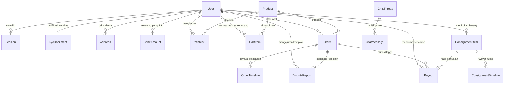

# Dokumentasi Lengkap Struktur & Isi Proyek Hingo (`Hinggo`)

> **Platform:** Titip Jual Gaming Gear Preloved Terverifikasi (*Consignment & Escrow Platform*)  
> **Tech Stack:** Next.js 16.4.3 (App Router, Turbopack) · React 19 · TypeScript · Tailwind CSS v4 · Prisma ORM (SQLite) · Supabase PostgreSQL (`@supabase/ssr`) · Baileys WhatsApp Web QR & Nodemailer OTP  
> **Supabase Project:** `https://obdczozspvkdebhtyhoh.supabase.co`

---

## 1. Ikhtisar Arsitektur & Fitur Utama

Hinggo adalah platform e-commerce titip jual (*managed consignment*) khusus peripheral gaming second hand (keyboard mekanikal, mouse gaming, headset, monitor, dan aksesoris) dengan sistem inspeksi fisik oleh tim Hingo dan perlindungan pembayaran bersama (*escrow rekber*).

### Arsitektur Inti:
1. **Next.js 16 App Router & React 19:** Server Components untuk SEO dan performa tinggi, Client Components untuk interaktivitas dinamis (store, cart, chat, tabs).
2. **Dual-Layer Database Sync:**
   - **Supabase PostgreSQL:** Cloud database utama (`users`, `products`, `orders`, `consignments`, `wishlists`, `cart_items`, `chat_messages`, `otp_verifications`, dll) dengan Row-Level Security (RLS).
   - **Prisma (SQLite `dev.db`):** Fallback lokal berkecepatan tinggi dengan skema identik, memastikan aplikasi tetap berjalan cepat dan toleran saat offline/transisi.
3. **Guest-First Security & Persistent Session:**
   - Pengunjung umum dapat menelusuri katalog, detail barang, panduan, dan promo tanpa login.
   - Halaman privat (`/account`, `/cart`, `/checkout`, `/wishlist`, `/orders`, `/seller/*`, `/chat/*`) diproteksi oleh `src/middleware.ts`.
   - Pengguna yang belum login otomatis diarahkan ke `/auth/login` dengan parameter `callbackUrl`.
   - Sesi pengguna disimpan dalam cookie HTTP-only (`hingo_user_id` & `hingo_session`) yang bertahan selama **30 hari**.
4. **Real OTP Delivery (WhatsApp & Email):**
   - **WhatsApp Gateway:** Menggunakan `@whiskeysockets/baileys` dengan sesi QR Web terintegrasi di `/api/whatsapp/qr`, dengan fallback otomatis ke REST API Fonnte.
   - **Email Gateway:** Nodemailer SMTP dengan HTML template Hingo yang elegan.
5. **Zero Dummy Catalog & Pure Database Driven:**
   - Katalog, keranjang, wishlist, dan chat dimulai dari kondisi murni (0 data) dari database, tidak ada mock data yang di-hardcode.

---

## 2. Struktur Pohon Direktori (Directory Tree)

```text
Hinggo/
├── .env                                  # Konfigurasi environment (Supabase, Database URL)
├── .env.example                          # Template konfigurasi environment
├── .env.local                            # Kredensial lokal Supabase & SMTP/WhatsApp
├── .gitignore                            # Berkas yang diabaikan Git
├── AGENTS.md                             # Aturan agen AI Next.js 16 Turbopack
├── eslint.config.mjs                     # Konfigurasi ESLint
├── HINGGO_PROJECT_STRUCTURE.md           # Berkas dokumentasi ini
├── next-env.d.ts                         # Tipe bawaan Next.js
├── next.config.ts                        # Konfigurasi Next.js (serverExternalPackages: baileys, pino)
├── package.json                          # Daftar dependensi & npm scripts
├── package-lock.json                     # Lockfile npm
├── prompt_antigravity_project_hinggo.md  # Dokumen spesifikasi instruksi master
├── README.md                             # Dokumentasi pengantar proyek
├── tsconfig.json                         # Konfigurasi compiler TypeScript
├── tsconfig.tsbuildinfo                  # Metadata build incremental TypeScript
│
├── prisma/
│   ├── dev.db                            # SQLite database lokal
│   ├── schema.prisma                     # Definisi 12 model relasi Prisma ORM
│   └── seed.ts                           # Script seed database
│
├── public/                               # Aset statis & ikon SVG
│   ├── file.svg
│   ├── globe.svg
│   ├── next.svg
│   ├── vercel.svg
│   └── window.svg
│
├── scripts/                              # Skrip utilitas CLI & pengujian
│   ├── clean-db.ts                       # Skrip pengosongan data dummy database
│   └── test-auth-profile.ts              # Pengujian alur OTP, sesi, dan akun pengguna
│
├── supabase/
│   └── schema.sql                        # Definisi 11 tabel PostgreSQL & RLS Supabase
│
└── src/
    ├── middleware.ts                     # Next.js Middleware: route protection & session refresh
    │
    ├── app/                              # Next.js App Router (Halaman & API Routes)
    │   ├── favicon.ico
    │   ├── globals.css                   # Global CSS & Tailwind CSS v4 variables
    │   ├── layout.tsx                    # Root Layout (Font Inter, StoreProvider, Nav, Footer)
    │   ├── page.tsx                      # Beranda Utama (Hero, Kategori, Fitur, Jaminan)
    │   │
    │   ├── account/
    │   │   └── page.tsx                  # Dashboard Akun Pengguna (Profil, KYC, Alamat, Bank)
    │   │
    │   ├── admin/
    │   │   └── page.tsx                  # Dashboard Admin (Inspeksi, Antrean Titip, Payout, KYC)
    │   │
    │   ├── auth/
    │   │   ├── login/
    │   │   │   └── page.tsx              # Halaman Login 2-Kolom Figma (Phone/Email OTP, WA QR)
    │   │   ├── verify-identity/
    │   │   │   └── page.tsx              # Formulir Verifikasi Identitas KYC (KTP & Selfie)
    │   │   └── verify-otp/
    │   │       └── page.tsx              # Input 6-Digit OTP dengan Timer Countdown
    │   │
    │   ├── cart/
    │   │   └── page.tsx                  # Keranjang Belanja Interaktif & Ringkasan Biaya
    │   │
    │   ├── catalog/
    │   │   └── page.tsx                  # Katalog Barang (Filter Kategori, Urutkan, Kondisi)
    │   │
    │   ├── chat/
    │   │   ├── product/
    │   │   │   └── page.tsx              # Konsultasi Chat Produk (Pembeli & Admin/Penjual)
    │   │   └── support/
    │   │       └── page.tsx              # Live Chat Customer Service Bantuan Hingo
    │   │
    │   ├── checkout/
    │   │   ├── page.tsx                  # Alur Checkout (Pilih Alamat, Kurir, Rekber Escrow)
    │   │   └── payment/[orderId]/
    │   │       └── page.tsx              # Instruksi Pembayaran (Virtual Account BCA / QRIS)
    │   │
    │   ├── how-it-works/
    │   │   └── page.tsx                  # Halaman Panduan Cara Kerja Titip Jual & Escrow
    │   │
    │   ├── orders/
    │   │   ├── page.tsx                  # Daftar Riwayat Pesanan Pembeli (Filter Status)
    │   │   └── [id]/
    │   │       ├── page.tsx              # Detail Pesanan, Timeline Ekspedisi, Konfirmasi Paket
    │   │       └── dispute/
    │   │           └── page.tsx          # Formulir Pengajuan Komplain / Sengketa Escrow
    │   │
    │   ├── product/
    │   │   └── [slug]/
    │   │       └── page.tsx              # Detail Produk: Galeri Foto, Hasil Cek Fisik, Beli
    │   │
    │   ├── promo/
    │   │   └── page.tsx                  # Halaman Promosi & Diskon
    │   │
    │   ├── seller/
    │   │   ├── consignments/
    │   │   │   ├── page.tsx              # Daftar Barang Titip Jual Penjual
    │   │   │   ├── new/
    │   │   │   │   └── page.tsx          # Multi-step Form Pengajuan Titip Jual Baru
    │   │   │   └── [code]/
    │   │   │       ├── page.tsx          # Status Detail Barang Titip & Persetujuan Harga
    │   │   │       ├── revise/
    │   │   │       │   └── page.tsx      # Upload Revisi Foto/Informasi Tambahan
    │   │   │       └── ship/
    │   │   │           └── page.tsx      # Input Nomor Resi Pengiriman ke Gudang Hingo
    │   │   └── payouts/
    │   │       └── page.tsx              # Laporan Pencairan Dana Penjual & Bukti Transfer
    │   │
    │   ├── wishlist/
    │   │   └── page.tsx                  # Daftar Barang Impian (Wishlist) Pengguna
    │   │
    │   └── api/                          # REST API Handlers (Route Handlers)
    │       ├── admin/route.ts            # API Statistik & Kontrol Admin
    │       ├── auth/
    │       │   ├── kyc/route.ts          # API Upload Dokumen KYC Identitas
    │       │   ├── send-otp/route.ts     # API Pengiriman OTP via WA / Email
    │       │   ├── session/route.ts      # API Pengecekan Sesi Pengguna
    │       │   └── verify-otp/route.ts   # API Validasi OTP & Pembuatan Sesi 30 Hari
    │       ├── cart/route.ts             # API CRUD Keranjang Belanja (Supabase & Prisma)
    │       ├── chat/route.ts             # API Pesan & Thread Chat Real-Time
    │       ├── checkout/route.ts         # API Pembuatan Order Baru & Transaksi Escrow
    │       ├── consignments/
    │       │   ├── route.ts              # API Daftar & Buat Titip Jual
    │       │   └── [code]/route.ts       # API Detail & Update Status Titip Jual
    │       ├── orders/
    │       │   ├── route.ts              # API Riwayat Pesanan
    │       │   └── [id]/
    │       │       ├── route.ts          # API Detail & Konfirmasi Terima Barang
    │       │       └── dispute/route.ts  # API Laporan Komplain Pesanan
    │       ├── payouts/route.ts          # API Rekap Pencairan Dana
    │       ├── products/
    │       │   ├── route.ts              # API Katalog Produk & Hitungan Dinamis Kategori
    │       │   └── [slug]/route.ts       # API Detail Produk Tunggal
    │       ├── user/
    │       │   ├── addresses/route.ts    # API CRUD Buku Alamat Pengiriman
    │       │   ├── bank-accounts/route.ts# API CRUD Rekening Bank & E-Wallet Penarikan
    │       │   ├── link-contact/route.ts # API Verifikasi & Tautkan Kontak Sekunder
    │       │   └── profile/route.ts      # API Pembaruan Profil & Avatar Pengguna
    │       ├── whatsapp/qr/route.ts      # API Gateway Baileys QR Code WhatsApp
    │       └── wishlist/
    │           ├── route.ts              # API Pengambilan Wishlist
    │           └── toggle/route.ts       # API Tambah/Hapus Wishlist (Supabase Sync)
    │
    ├── components/                       # Komponen UI Reusable
    │   ├── layout/
    │   │   ├── Footer.tsx                # Footer Desktop & Mobile dengan Link Bantuan
    │   │   ├── MobileBottomNav.tsx       # Bottom Bar Navigasi Mobile (Beranda, Katalog, Titip, Transaksi, Akun)
    │   │   └── Navbar.tsx                # Navbar Utama: Search Bar, Kategori, Indikator Auth, Cart & Wishlist Badge
    │   └── ui/
    │       ├── ProductCard.tsx           # Kartu Display Produk (Badge Kondisi, Harga, Wishlist Heart)
    │       ├── RoleSwitcherWidget.tsx    # Widget Cepat untuk Ganti Role Demo (USER/ADMIN)
    │       └── StatusBadge.tsx           # Badge Berwarna untuk Status Pesanan & Titip Jual
    │
    ├── lib/                              # Pustaka & Utilitas Bisnis
    │   ├── auth.ts                       # Helper Otentikasi, Sesi 30 Hari, Pengecekan Cookie
    │   ├── data.ts                       # Definisi Tipe TypeScript Global & Konstanta Kategori
    │   ├── otp-sender.ts                 # Engine Pengirim OTP (Nodemailer SMTP & Phone Sanitizer)
    │   ├── prisma.ts                     # Inisialisasi Singleton Prisma Client
    │   ├── store.tsx                     # Global State Management (React Context)
    │   ├── supabase.ts                   # Inisialisasi Singleton Supabase Client
    │   └── whatsapp-gateway.ts           # Baileys WhatsApp Socket Gateway & Fonnte Fallback
    │
    └── utils/
        └── supabase/                     # Supabase SSR Helpers Resmi
            ├── client.ts                 # `createBrowserClient` untuk sisi klien
            ├── middleware.ts             # `createServerClient` dengan Cookie Handlers NextRequest/Response
            └── server.ts                 # `createServerClient` dengan Next.js Server Cookies
```

---

## 3. Rincian Modul & Fungsionalitas Halaman

### A. Otentikasi & Akun (`/auth` & `/account`)
| Rute Halaman | File Path | Fungsi Utama |
|---|---|---|
| `/auth/login` | `src/app/auth/login/page.tsx` | Halaman login otentik Figma 2-kolom: tab Nomor WhatsApp & Email, tombol masuk Google, modal penghubung WhatsApp Web QR (`@whiskeysockets/baileys`). |
| `/auth/verify-otp` | `src/app/auth/verify-otp/page.tsx` | Input 6 digit OTP otomatis maju ke kotak berikutnya, tombol kirim ulang dengan timer hitung mundur. |
| `/auth/verify-identity`| `src/app/auth/verify-identity/page.tsx` | Pengajuan KYC seller/buyer: upload foto KTP dan selfie, NIK disensor otomatis demi privasi. |
| `/account` | `src/app/account/page.tsx` | Profil komprehensif 5-tab: (1) Profil & Avatar (bisa ganti preset/URL), (2) Status Verifikasi KYC, (3) Buku Alamat Pengiriman, (4) Rekening Pencairan Bank/E-Wallet, (5) Keamanan & Logout. Dilengkapi 4 kartu metrik live (Pesanan, Titip Jual, Wishlist, Total Pencairan). |

### B. Belanja & Transaksi Escrow (`/catalog`, `/product`, `/cart`, `/checkout`, `/orders`)
| Rute Halaman | File Path | Fungsi Utama |
|---|---|---|
| `/` | `src/app/page.tsx` | Beranda utama dengan Hero Banner dinamis, tombol kategori dengan hitungan real-time, produk pilihan, serta alur rekber Hingo. |
| `/catalog` | `src/app/catalog/page.tsx` | Menampilkan produk terverifikasi dengan filter kategori (Keyboard, Mouse, Headset, Monitor, Aksesoris), pengurutan harga, dan kondisi. Menampilkan *empty state* krem `#FFFBEB` bila 0 barang. |
| `/product/[slug]` | `src/app/product/[slug]/page.tsx` | Halaman detail produk: galeri visual, spesifikasi teknis, catatan hasil inspeksi fisik oleh tim Hingo, tombol Beli Sekarang dan Tambah ke Keranjang. |
| `/cart` | `src/app/cart/page.tsx` | Daftar keranjang belanja dengan checkbox pilihan per item, centang semua, kalkulasi otomatis subtotal dan proteksi. |
| `/checkout` | `src/app/checkout/page.tsx` | Pemilihan alamat utama, kurir ekspedisi (JNE, SiCepat, GoSend), metode pembayaran (BCA Virtual Account / QRIS), dan ringkasan biaya proteksi escrow. |
| `/checkout/payment/[orderId]` | `src/app/checkout/payment/[orderId]/page.tsx` | Menampilkan nomor rekening VA / QR Code QRIS, nominal eksak, dan countdown batas pembayaran 2 jam. |
| `/orders` | `src/app/orders/page.tsx` | Pelacakan pesanan pembeli dengan tab: Menunggu Pembayaran, Diproses, Dikirim, Perlu Dicek, Selesai, dan Komplain. |
| `/orders/[id]` | `src/app/orders/[id]/page.tsx` | Detail pesanan, nomor resi pengiriman, timeline perjalanan paket, tombol Konfirmasi Terima Barang (melepas dana ke seller), dan tombol Ajukan Komplain. |
| `/orders/[id]/dispute` | `src/app/orders/[id]/dispute/page.tsx` | Formulir pelaporan barang tidak sesuai / cacat dalam masa garansi periksa 48 jam disertai bukti foto/video. |

### C. Titip Jual & Seller Dashboard (`/seller`)
| Rute Halaman | File Path | Fungsi Utama |
|---|---|---|
| `/seller/consignments` | `src/app/seller/consignments/page.tsx` | Daftar barang titip jual milik seller dengan status alur (Cek Online, Kirim ke Hingo, Diinspeksi, Disetujui, Terjual). |
| `/seller/consignments/new` | `src/app/seller/consignments/new/page.tsx` | Formulir multi-tahap titip jual: Kategori barang, merk & tipe, kelengkapan, durasi pemakaian, kondisi & minus, unggah foto, dan taksiran harga jual. |
| `/seller/consignments/[code]` | `src/app/seller/consignments/[code]/page.tsx` | Rincian status titip jual, timeline inspeksi teknis gudang Hingo, konfirmasi persetujuan harga taksiran akhir. |
| `/seller/consignments/[code]/ship` | `src/app/seller/consignments/[code]/ship/page.tsx` | Input nomor resi pengiriman barang dari seller ke kantor kurasi Hingo. |
| `/seller/consignments/[code]/revise`| `src/app/seller/consignments/[code]/revise/page.tsx`| Unggah foto atau klarifikasi tambahan jika kurator meminta revisi saat cek awal. |
| `/seller/payouts` | `src/app/seller/payouts/page.tsx` | Riwayat pelepasan dana hasil penjualan barang titip ke rekening penjual lengkap dengan potongan fee admin dan bukti transfer bank. |

### D. Chat & Dukungan Pelanggan (`/chat`)
| Rute Halaman | File Path | Fungsi Utama |
|---|---|---|
| `/chat/product` | `src/app/chat/product/page.tsx` | Fitur pesan instan terhubung langsung dengan admin kurator produk untuk menanyakan kelengkapan atau foto detail unit. |
| `/chat/support` | `src/app/chat/support/page.tsx` | Live chat konsultasi dan bantuan cepat kendala transaksi atau klaim garansi. |

### E. Portal Administrasi Hingo (`/admin`)
| Rute Halaman | File Path | Fungsi Utama |
|---|---|---|
| `/admin` | `src/app/admin/page.tsx` | Panel kontrol internal untuk: Verifikasi dokumen KYC user, Penilaian & inspeksi fisik barang titip masuk, Input harga rekomendasi, Persetujuan pencairan dana payout ke seller, dan Mediasi komplain pembeli. |

---

## 4. Rincian API Handlers (`src/app/api/`)

Semua endpoint API dibangun menggunakan Next.js Route Handlers (`route.ts`) dengan validasi input, dual-layer sync ke Supabase dan Prisma, serta proteksi keamanan:

1. **`POST /api/auth/send-otp`**: Menerima `{ target: string, channel: 'WHATSAPP' | 'EMAIL' }`. Menghasilkan 6 digit kode acak dengan masa berlaku 5 menit, menyimpannya di DB, lalu mengirimkan via Baileys WhatsApp / Fonnte / Nodemailer SMTP.
2. **`POST /api/auth/verify-otp`**: Memvalidasi kode OTP. Jika cocok, membuat atau memperbarui profil user di Supabase & Prisma, membentuk sesi 30 hari, dan memasang HTTP-only cookie `hingo_user_id` serta `hingo_session`. Mengembalikan `{ success: true, redirectTo: '/account' }`.
3. **`GET /api/auth/session`**: Memeriksa sesi aktif dari cookie atau bearer token dan mengembalikan data profil user lengkap.
4. **`POST /api/auth/kyc`**: Menerima upload data KTP dan foto selfie untuk verifikasi identitas pengguna.
5. **`GET /api/products` & `GET /api/products/[slug]`**: Mengambil daftar produk dari database Supabase dengan hitungan jumlah produk per kategori yang dinamis dan nol-dummy.
6. **`GET /api/cart` & `POST /api/cart` & `DELETE /api/cart`**: Manajemen keranjang belanja pengguna yang tersinkronisasi otomatis dengan akun di cloud.
7. **`GET /api/wishlist` & `POST /api/wishlist/toggle`**: Toggle wishlist barang impian dengan sinkronisasi ke tabel `public.wishlists`.
8. **`POST /api/checkout`**: Memproses order pembelian dengan penahanan dana (*escrow hold*), penentuan kurir, dan pembuatan kode pembayaran unik.
9. **`GET /api/orders` & `GET /api/orders/[id]`**: Menampilkan status pengiriman dan detail transaksi.
10. **`POST /api/orders/[id]`**: Memperbarui status pesanan (misal: Konfirmasi Terima Barang `COMPLETED` yang memicu pelepasan saldo penjual).
11. **`POST /api/orders/[id]/dispute`**: Menampung klaim komplain pembeli jika barang bermasalah.
12. **`GET /api/consignments` & `POST /api/consignments`**: Pendaftaran dan pengambilan status barang titip jual.
13. **`GET /api/consignments/[code]` & `PATCH /api/consignments/[code]`**: Pembaruan status kurasi dan konfirmasi persetujuan harga jual.
14. **`GET /api/payouts`**: Rekap pencairan dana penjualan ke rekening bank seller.
15. **`GET /api/user/profile` & `PATCH /api/user/profile`**: Mengambil dan memperbarui informasi nama, kota, bio, dan foto profil avatar.
16. **`GET /api/user/addresses` & `POST /api/user/addresses` & `DELETE /api/user/addresses`**: CRUD buku alamat pengiriman.
17. **`GET /api/user/bank-accounts` & `POST /api/user/bank-accounts`**: CRUD rekening bank & e-wallet tujuan pencairan.
18. **`POST /api/user/link-contact`**: Tautan kontak kedua (misal menghubungkan email pada akun yang didaftarkan lewat nomor WhatsApp).
19. **`GET /api/whatsapp/qr`**: Menginisialisasi koneksi socket Baileys WhatsApp Web dan menyalurkan gambar QR code dalam format data URL untuk scan login.
20. **`GET /api/chat` & `POST /api/chat`**: Menyimpan dan mengambil pesan instan dengan respon bot pintar otomatis.

---

## 5. Skema Basis Data (Database Models)

Sistem database dirancang secara sinkron antara `prisma/schema.prisma` dan `supabase/schema.sql`:



### Rincian Tabel:
1. **`users` (`User`)**: Akun pengguna, peran (`USER`, `ADMIN`, `CS`), status verifikasi nomor telepon, email, dan KYC.
2. **`sessions` (`Session`)**: Token sesi 30 hari yang terikat dengan user ID dan cookie peramban.
3. **`otp_verifications` (`OtpVerification`)**: Penyimpanan sementara kode OTP 6-digit beserta masa kadaluarsa (5 menit).
4. **`kyc_documents` (`KycDocument`)**: Data nama lengkap KTP, NIK yang disamarkan (*masked*), dan URL foto KTP/selfie.
5. **`addresses` (`Address`)**: Alamat pengiriman (Rumah, Kantor, Kos) dengan status alamat utama (*isPrimary*).
6. **`bank_accounts` (`BankAccount`)**: Rekening bank (BCA, Mandiri, BRI, BNI) atau e-wallet (GoPay, OVO, DANA) untuk pencairan.
7. **`products` (`Product`)**: Katalog barang preloved gaming terverifikasi, spesifikasi switch/varian, harga, rating, dan status ketersediaan.
8. **`wishlists` (`Wishlist`)**: Relasi banyak-ke-banyak antara user dan produk yang disukai.
9. **`cart_items` (`CartItem`)**: Item keranjang belanja aktif lengkap dengan status centang (*selected*).
10. **`orders` (`Order`)**: Data transaksi escrow rekber, kurir, nomor resi, nominal ongkir & proteksi, serta status pesanan.
11. **`order_timelines` (`OrderTimeline`)**: Jejak langkah kronologis pengiriman pesanan.
12. **`consignments` (`ConsignmentItem`)**: Permohonan titip jual gear, riwayat kurasi gudang, hasil uji fungsional, dan negosiasi harga.
13. **`consignments_timeline` (`ConsignmentTimeline`)**: Riwayat tahapan titip jual barang dari seller ke gudang hingga laku.
14. **`payouts` (`Payout`)**: Pencairan dana penjualan ke rekening penjual setelah garansi 48 jam pembeli terpenuhi.
15. **`disputes` (`DisputeReport`)**: Laporan kendala barang oleh pembeli dengan status penahanan dana.
16. **`chat_threads` & `chat_messages`**: Obrolan interaktif antara pembeli, penjual, dan tim kurator Hingo.

---

## 6. Variabel Lingkungan (`.env` / `.env.local`)

Untuk menjalankan seluruh fungsionalitas secara sempurna, variabel berikut dikonfigurasi pada proyek:

```env
# Supabase Resmi
NEXT_PUBLIC_SUPABASE_URL=https://obdczozspvkdebhtyhoh.supabase.co
NEXT_PUBLIC_SUPABASE_PUBLISHABLE_KEY=sb_publishable_qYJsxxD04jDxX2WXPPysTg_vf8IY1AN

# Database Prisma Lokal (Fallback & Fast Cache)
DATABASE_URL="file:./dev.db"

# WhatsApp Gateway (Fonnte API Token opsional untuk fallback otomatis)
FONNTE_TOKEN=

# Email OTP Gateway (Nodemailer SMTP)
SMTP_HOST=smtp.gmail.com
SMTP_PORT=587
SMTP_USER=
SMTP_PASS=
SMTP_FROM="Hingo Indonesia <no-reply@hingo.id>"
```

---

## 7. Cara Menjalankan Proyek Secara Lokal

1. **Pasang Dependensi:**
   ```bash
   npm install
   ```

2. **Generate Client Prisma & Sinkronisasi Database:**
   ```bash
   npx prisma generate
   npx prisma db push
   ```

3. **Jalankan Mode Pengembangan (Turbopack):**
   ```bash
   npm run dev
   ```
   Aplikasi akan aktif dan dapat diakses di `http://localhost:3000`.

4. **Kompilasi Uji Produksi (Production Build):**
   ```bash
   npm run build
   ```
   *Catatan: Seluruh 40 rute halaman dan API berhasil dikompilasi 100% tanpa error TypeScript maupun Turbopack.*
