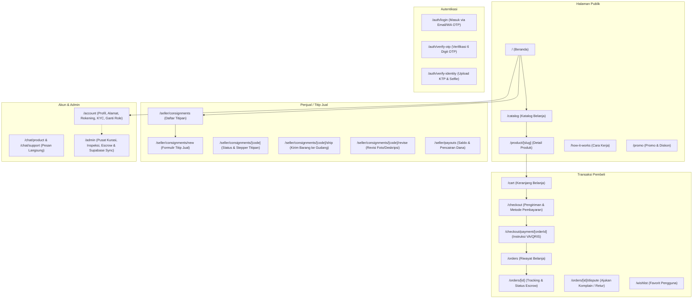

# PANDUAN LENGKAP QA & QC (QUALITY ASSURANCE & CONTROL)
## Aplikasi Hinggo — Recommerce & Escrow Titip Jual Gaming Gear Terverifikasi

Dokumen ini disusun sebagai acuan tunggal pengujian kualitas (**QA/QC Testing**) untuk memvalidasi seluruh fungsi, alur bisnis, keandalan sesi pengguna, dan integrasi database ganda (**Prisma SQLite & Supabase Cloud**).

---

## DAFTAR ISI
1. [Ringkasan Arsitektur & Environment Matrix](#1-ringkasan-arsitektur--environment-matrix)
2. [Peta Rute & Modul Aplikasi (Sitemap Matrix)](#2-peta-rute--modul-aplikasi-sitemap-matrix)
3. [Akun Uji Cepat & Kredensial Demo](#3-akun-uji-cepat--kredensial-demo)
4. [Skenario Pengujian Fungsional (Langkah demi Langkah)](#4-skenario-pengujian-fungsional-langkah-demi-langkah)
   - [Modul A: Autentikasi & Manajemen Sesi Pengguna](#modul-a-autentikasi--manajemen-sesi-pengguna)
   - [Modul B: Pengalaman Pembeli (Katalog, Filter, Detail, Wishlist, Keranjang)](#modul-b-pengalaman-pembeli-katalog-filter-detail-wishlist-keranjang)
   - [Modul C: Checkout & Escrow Rekber Hingo](#modul-c-checkout--escrow-rekber-hingo)
   - [Modul D: Manajemen Pesanan, Pelacakan & Garansi 48 Jam](#modul-d-manajemen-pesanan-pelacakan--garansi-48-jam)
   - [Modul E: Penjual (Titip Jual / Konsinyasi & Auto-Save Draft)](#modul-e-penjual-titip-jual--konsinyasi--auto-save-draft)
   - [Modul F: Pengaturan Akun, Profil, KYC & Rekening](#modul-f-pengaturan-akun-profil-kyc--rekening)
   - [Modul G: Super Admin Control Panel](#modul-g-super-admin-control-panel)
   - [Modul H: Integrasi Database Supabase Cloud](#modul-h-integrasi-database-supabase-cloud)
   - [Modul I: Responsivitas Mobile (Thumb-Friendly UI)](#modul-i-responsivitas-mobile-thumb-friendly-ui)
5. [Lembar Kerja Eksekusi QA / QC (Checklist Tabel)](#5-lembar-kerja-eksekusi-qa--qc-checklist-tabel)

---

## 1. Ringkasan Arsitektur & Environment Matrix

| Parameter | Spesifikasi Teknis |
|---|---|
| **Framework** | Next.js 16.4.3 (App Router, Turbopack, React 19) |
| **Styling** | Tailwind CSS v4, Lucide React Icons |
| **Produksi URL** | `https://hinggo.vercel.app` |
| **Database Cloud** | Supabase PostgreSQL (`https://obdczozspvkdebhtyhoh.supabase.co`) |
| **Database Lokal** | SQLite Prisma (`file:./dev.db`) |
| **Model Sinkronisasi** | Dual-Write (Prisma + Supabase) & Dual-Read dengan Safe Fallback |
| **Sesi Login** | Cookie HTTP-Only Signed HMAC-SHA256 (`hingo_session`), `hingo_user_id`, `hingo_user_email` (Durasi: 30 Hari) |
| **Auto-Save Draft** | LocalStorage terisolasi per email (`hingo_consignment_draft_${email}`) |

---

## 2. Peta Rute & Modul Aplikasi (Sitemap Matrix)

---

## 3. Akun Uji Cepat & Kredensial Demo

Untuk pengujian cepat tanpa menunggu SMS/Email sesungguhnya, gunakan **Master Demo OTP**: `123456`.

| Tipe Akun | Identifier Login | Kode OTP Demo | Role Akses | Tujuan Uji |
|---|---|---|---|---|
| **Admin Utama** | `admin@hingo.id` atau `+6281200000001` | `123456` | `ADMIN` | Verifikasi dashboard admin, kurasi, penentuan harga, rilis escrow |
| **Seller A** | `seller1@gmail.com` | `123456` | `USER` | Pengajuan titip jual, auto-save draft, tracking status gear |
| **Buyer B** | `buyer1@gmail.com` | `123456` | `USER` | Belanja, keranjang, checkout, pembayaran escrow, konfirmasi rilis |
| **Akun WA Baru** | `081298765432` | `123456` | `USER` | Pengguna baru nomor WhatsApp otomatis mendapatkan email dummy `@wa.hingo.id` |

> [!TIP]
> Anda dapat berganti peran secara instan antara `USER` dan `ADMIN` di halaman **`/account`** dengan menekan tombol **"Beralih ke Tampilan Admin"**.

---

## 4. Skenario Pengujian Fungsional (Langkah demi Langkah)

### Modul A: Autentikasi & Manajemen Sesi Pengguna
> **Tujuan:** Memastikan sesi login aman, tidak mudah logout sendiri, terkunci pada email, dan kebal saat halaman di-refresh.

- [ ] **TC-AUTH-01: Login dengan Email & OTP Demo**
  1. Buka `/auth/login`.
  2. Masukkan email: `tester1@gmail.com`.
  3. Klik **"Kirim Kode Verifikasi"**.
  4. Halaman berpindah ke `/auth/verify-otp`.
  5. Masukkan kode demo `123456` (atau klik tombol isi otomatis).
  6. **Hasil yang diharapkan:** Langsung dialihkan ke Beranda (`/`). Tombol header berubah dari *"Masuk"* menjadi profil nama pengguna. Cookie `hingo_user_email` dan `hingo_session` terpasang (durasi 30 hari).
- [ ] **TC-AUTH-02: Kebal Refresh (Refresh Immunity)**
  1. Tekan tombol refresh browser (<kbd>F5</kbd> atau <kbd>Ctrl</kbd> + <kbd>R</kbd>) di halaman mana saja.
  2. **Hasil yang diharapkan:** Sesi tetap aktif, tidak terlempar ke halaman login, data nama profil tetap muncul.
- [ ] **TC-AUTH-03: Login dengan Nomor WhatsApp**
  1. Logout dari akun sebelumnya.
  2. Buka `/auth/login`, masukkan nomor: `081299887766`.
  3. Masukkan OTP `123456`.
  4. **Hasil yang diharapkan:** Berhasil masuk, email otomatis dibuat `081299887766@wa.hingo.id`, profil terdaftar di Supabase dan SQLite.
- [ ] **TC-AUTH-04: Logout Akun**
  1. Buka `/account`, gulir ke bawah dan klik tombol merah **"Keluar dari Akun"**.
  2. **Hasil yang diharapkan:** Cookie terhapus, state tereset bersih, dialihkan ke `/` dan tombol header kembali bertuliskan *"Masuk"*.

---

### Modul B: Pengalaman Pembeli (Katalog, Filter, Detail, Wishlist, Keranjang)
> **Tujuan:** Memastikan penjelajahan barang titipan cepat, filter responsif, dan sinkronisasi keranjang/wishlist bekerja.

- [ ] **TC-CAT-01: Navigasi Kategori & Filter**
  1. Buka `/catalog`.
  2. Klik tab kategori: `KEYBOARD`, `MOUSE`, `HEADSET`, `MONITOR`, `ACCESSORIES`.
  3. Coba ketik kata kunci pada kotak pencarian (misal: *"Keychron"* atau *"Logitech"*).
  4. Pilih filter kondisi (*"Sangat baik"* / *"Baik"*).
  5. Pilih urutan harga (*Termurah*, *Termahal*, *Terpopuler*).
  6. **Hasil yang diharapkan:** Daftar barang terfilter seketika tanpa reload halaman penuh.
- [ ] **TC-CAT-02: Detail Produk & Transparansi Fisik**
  1. Klik salah satu produk yang tersedia di `/catalog`.
  2. Halaman detail `/product/[slug]` terbuka.
  3. Geser galeri foto produk.
  4. Periksa blok **"Laporan Inspeksi Hingo"** (catatan fungsi, switch, kelengkapan, dan foto cacat fisik).
  5. **Hasil yang diharapkan:** Foto dan spesifikasi lengkap tampil jelas, badge verifikasi terlihat.
- [ ] **TC-CAT-03: Toggle Wishlist (Favorit)**
  1. Klik tombol ikon hati di kartu produk atau di halaman detail produk.
  2. Buka halaman `/wishlist`.
  3. **Hasil yang diharapkan:** Produk muncul di daftar wishlist. Angka badge wishlist di header bertambah. Data tersimpan di Supabase `wishlists`.
- [ ] **TC-CAT-04: Keranjang Belanja (Cart)**
  1. Pada halaman detail produk, klik **"Tambah ke Keranjang"**.
  2. Buka `/cart`.
  3. Coba centang/uncentang item untuk melihat update total belanja.
  4. Klik tombol hapus item.
  5. **Hasil yang diharapkan:** Perhitungan subtotal akurat, item sinkron dengan tabel `cart_items`.

---

### Modul C: Checkout & Escrow Rekber Hingo
> **Tujuan:** Memastikan dana pembeli diamankan di rekening penampungan bersama (escrow) dan tidak langsung masuk ke rekening seller sebelum barang diterima & diuji.

- [ ] **TC-CHK-01: Ringkasan Biaya Checkout**
  1. Dari keranjang belanja (`/cart`) atau langsung klik **"Beli Sekarang"** di detail produk.
  2. Masuk ke halaman `/checkout`.
  3. Periksa rincian biaya:
     - Harga Barang
     - Ongkos Kirim (pilihan: JNE REG / J&T / SiCepat)
     - Asuransi Proteksi Pengiriman (Rp5.000)
     - Biaya Layanan Rekber Hingo (Rp2.500)
  4. **Hasil yang diharapkan:** Total bayar merupakan penjumlahan tepat dari 4 komponen biaya di atas.
- [ ] **TC-CHK-02: Pemilihan & Penambahan Alamat Pengiriman**
  1. Di `/checkout`, pilih alamat yang sudah tersimpan atau klik **"+ Tambah Alamat Baru"**.
  2. Isi nama penerima, nomor HP, kota, alamat lengkap, dan kode pos.
  3. **Hasil yang diharapkan:** Alamat tersimpan ke database `addresses` dan langsung terpilih sebagai tujuan pengiriman.
- [ ] **TC-CHK-03: Pembuatan Pesanan & Instruksi Pembayaran (Virtual Account / QRIS)**
  1. Pilih metode pembayaran: `BCA Virtual Account` atau `QRIS`.
  2. Klik tombol **"Bayar Sekarang & Amankan Dana"**.
  3. Sistem mengarahkan ke `/checkout/payment/[orderId]`.
  4. Tampil Nomor VA (contoh `8801 0812xxxx`) atau QR Code QRIS dengan batas waktu pembayaran.
  5. Klik tombol simulasi **"Simulasi Konfirmasi Pembayaran Berhasil"**.
  6. **Hasil yang diharapkan:** Status pesanan berubah menjadi `PAID_PACKING`, status dana escrow berubah menjadi `HELD_BY_HINGO` (Tertahan Aman). Notifikasi sukses muncul.

---

### Modul D: Manajemen Pesanan, Pelacakan & Garansi 48 Jam
> **Tujuan:** Memastikan perlindungan pembeli berfungsi dengan masa uji 48 jam dan tombol rilis dana.

- [ ] **TC-ORD-01: Riwayat Pesanan (`/orders`)**
  1. Buka menu `/orders`.
  2. Pastikan pesanan yang baru dibuat tampil dengan badge status yang sesuai.
- [ ] **TC-ORD-02: Halaman Detail Pesanan & Stepper Escrow (`/orders/[id]`)**
  1. Klik pesanan untuk membuka detailnya.
  2. Periksa alur stepper pelacakan:
     - *Menunggu Pembayaran* &rarr; *Dana Diamankan Hingo* &rarr; *Seller Mengemas* &rarr; *Dalam Pengiriman* &rarr; *Paket Tiba & Masa Uji 48 Jam* &rarr; *Selesai & Dana Dilepas*.
  3. Periksa nomor resi pengiriman kurir.
- [ ] **TC-ORD-03: Konfirmasi Terima & Rilis Dana Escrow**
  1. Pada status barang tiba (`DELIVERED_CHECKING`), pembeli menguji barang.
  2. Jika barang sesuai, klik tombol **"Konfirmasi Selesai & Lepas Dana ke Seller"**.
  3. **Hasil yang diharapkan:** Escrow status berubah menjadi `RELEASED_TO_SELLER`, pesanan berstatus `COMPLETED`, saldo seller bertambah di `/seller/payouts`.
- [ ] **TC-ORD-04: Pengajuan Komplain / Dispute (`/orders/[id]/dispute`)**
  1. Jika barang rusak atau tidak sesuai, klik tombol **"Ajukan Komplain / Retur"**.
  2. Pilih kategori masalah (Cacat fisik tersembunyi, fungsi bermasalah, kelengkapan kurang, atau tidak sesuai deskripsi).
  3. Masukkan deskripsi masalah dan upload foto/bukti.
  4. Klik **"Kirim Laporan Komplain"**.
  5. **Hasil yang diharapkan:** Dana escrow langsung dibekukan dengan status `DISPUTED`. Kasus masuk ke dashboard Admin Tab 5 (Dispute).

---

### Modul E: Penjual (Titip Jual / Konsinyasi & Auto-Save Draft)
> **Tujuan:** Memvalidasi pengajuan titip gear gaming dengan kalkulasi bagi hasil otomatis dan fitur auto-save draft anti-hilang.

- [ ] **TC-CON-01: Auto-Save Draft Form Titip Jual**
  1. Login sebagai seller, buka `/seller/consignments/new`.
  2. Pilih kategori: `KEYBOARD`.
  3. Ketik Nama/Model: `Keychron Q1 Pro Wireless`.
  4. Ketik Varian: `Barebone Knob Red Switch`.
  5. Ketik Ekspektasi Harga: `1800000`.
  6. **Lakukan simulasi musibah:** Refresh browser (<kbd>F5</kbd>) saat form belum di-submit!
  7. **Hasil yang diharapkan:** Data yang sudah diketik tidak hilang! Nilai form otomatis dipulihkan dari `hingo_consignment_draft_${email}`. Indikator *"Tersimpan otomatis"* aktif.
- [ ] **TC-CON-02: Kalkulator Transparansi Fee Otomatis**
  1. Periksa kotak rincian estimasi penerimaan dana saat mengetik nominal Rp1.800.000:
     - Biaya Titip Jual (8%): Rp144.000
     - Biaya Handling & Kurasi Admin: Rp19.000
     - Estimasi Bersih Diterima Seller: Rp1.637.000
  2. **Hasil yang diharapkan:** Kalkulasi real-time matematis tepat sesuai formula.
- [ ] **TC-CON-03: Kirim Pengajuan Titip Jual ke Database**
  1. Lengkapi foto barang, kondisi, catatan kelengkapan, dan kota asal.
  2. Klik tombol **"Kirim untuk Kurasi Hingo"**.
  3. **Hasil yang diharapkan:** Transaksi tersimpan ke Prisma SQLite dan Supabase Cloud (`public.consignments`). Kode titipan unik dibuat (format: `HG-YYMMDD-XXX`). Form dialihkan ke `/seller/consignments`.
- [ ] **TC-CON-04: Pelacakan Status Titip Jual (`/seller/consignments/[code]`)**
  1. Buka kartu titipan yang baru dibuat.
  2. Periksa status awal: `Menunggu kurasi online`.
  3. Saat admin meminta kirim unit fisik, buka `/seller/consignments/[code]/ship` untuk menginput nomor resi kirim ke gudang Hingo.
- [ ] **TC-CON-05: Isolasi Data Antar Seller**
  1. Buka `/seller/consignments` dengan Akun Seller A. Perhatikan barang yang muncul.
  2. Logout dan login dengan Akun Seller B.
  3. **Hasil yang diharapkan:** Barang milik Seller A **tidak terlihat sama sekali** di akun Seller B. Data terisolasi penuh berdasarkan email.

---

### Modul F: Pengaturan Akun, Profil, KYC & Rekening
> **Tujuan:** Memastikan pengelolaan profil pengguna, verifikasi identitas (KYC), alamat pengiriman, dan rekening bank penarikan dana berjalan lancar.

- [ ] **TC-ACC-01: Update Profil & Bio**
  1. Buka `/account`.
  2. Ubah nama tampilan, kota domisili, dan bio pengguna.
  3. Klik **"Simpan Perubahan"**.
  4. Refresh halaman.
  5. **Hasil yang diharapkan:** Perubahan tersimpan permanen di database dan tidak berubah kembali ke semula.
- [ ] **TC-ACC-02: Unggah Dokumen KYC (KTP & Selfie)**
  1. Di `/account`, buka bagian **"Verifikasi Identitas (KYC)"** atau kunjungi `/auth/verify-identity`.
  2. Isi Nama Sesuai KTP dan NIK.
  3. Upload foto KTP dan foto selfie.
  4. Klik **"Kirim Dokumen KYC"**.
  5. **Hasil yang diharapkan:** Status berubah menjadi `PENDING_REVIEW` dengan badge kuning. Data tersimpan di `kyc_documents`.
- [ ] **TC-ACC-03: Kelola Daftar Rekening Bank Pencairan**
  1. Pada bagian Rekening Bank, klik **"+ Tambah Rekening"**.
  2. Pilih bank (BCA / Mandiri / BRI / BNI / GoPay), masukkan nomor rekening dan nama pemilik.
  3. Simpan dan atur sebagai rekening utama (*Primary*).
  4. **Hasil yang diharapkan:** Data tersimpan di `bank_accounts` dan digunakan saat pencairan saldo seller.

---

### Modul G: Super Admin Control Panel (`/admin`)
> **Tujuan:** Memastikan seluruh alur verifikasi operasional dapat dikendalikan dari satu dashboard terpusat.

- [ ] **TC-ADM-01: Akses Role Admin**
  1. Pastikan sedang login dengan akun yang memiliki role `ADMIN` (misal: `admin@hingo.id`).
  2. Buka menu `/admin`.
  3. Periksa kartu metrik utama: Total Produk Tayang, Titip Jual Aktif, Pengguna Terdaftar, Transaksi Berjalan.
- [ ] **TC-ADM-02: Tab 1 — Persetujuan / Penolakan KYC Pengguna**
  1. Buka Tab 1 di Admin.
  2. Lihat daftar pengajuan KYC berstatus `PENDING_REVIEW`.
  3. Klik **"Setujui KYC"**.
  4. **Hasil yang diharapkan:** User berstatus `VERIFIED` dan mendapat centang hijau di profilnya.
- [ ] **TC-ADM-03: Tab 2 — Kurasi Foto & Spek Online Titipan**
  1. Buka Tab 2 di Admin.
  2. Tinjau foto gear yang diajukan seller.
  3. Jika foto kurang jelas, klik **"Minta Revisi"** beserta catatan alasannya.
  4. Jika layak, klik **"Loloskan & Minta Seller Kirim Fisik"**.
  5. **Hasil yang diharapkan:** Status titipan di sisi seller berganti menjadi instruksi kirim unit ke gudang.
- [ ] **TC-ADM-04: Tab 3 — Inspeksi Fisik, Grade & Tayang ke Katalog (Publish)**
  1. Saat barang tiba di gudang Hingo, admin mengisi hasil inspeksi (cek switch, koneksi, kelengkapan, uji fungsional 100%).
  2. Masukkan harga jual rekomendasi yang disepakati.
  3. Klik tombol **"Tayangkan ke Katalog Belanja"**.
  4. **Hasil yang diharapkan:** Barang otomatis bertransformasi menjadi Produk Baru di katalog belanja (`/catalog`), kode barang dibuat (`HG-PRD-xxxx`), dan langsung dapat dibeli oleh publik.
- [ ] **TC-ADM-05: Tab 4 — Pemantauan Escrow & Rilis Dana Manual**
  1. Buka Tab 4 di Admin.
  2. Periksa daftar dana tertampung di rekening Hingo (`HELD_BY_HINGO`).
  3. Admin memiliki opsi darurat untuk merilis dana ke seller jika masa garansi 48 jam telah terlewati tanpa komplain dari pembeli.
- [ ] **TC-ADM-06: Tab 5 — Mediasi Dispute & Resolusi Komplain**
  1. Buka Tab 5 saat ada komplain dari pembeli.
  2. Tinjau bukti foto dan kronologi dari pembeli serta tanggapan seller.
  3. Admin dapat memutuskan: **"Kembalikan Dana ke Pembeli (Refund)"** atau **"Lepas Dana ke Seller (Rilis)"**.

---

### Modul H: Integrasi Database Supabase Cloud
> **Tujuan:** Memvalidasi koneksi langsung ke Supabase Cloud dan ketersediaan seluruh tabel cloud.

- [ ] **TC-SUPA-01: Status Koneksi Supabase di Admin**
  1. Buka `/admin` &rarr; Tab 6: **"Supabase & Database Cloud"**.
  2. Periksa indikator badge:
     - Status: `Terhubung Aktif` (Hijau)
     - URL Project: `https://obdczozspvkdebhtyhoh.supabase.co`
     - Status 8 Tabel Utama: `products` (OK), `users` (OK), `consignments` (OK), `orders` (OK), `cart_items` (OK), `wishlists` (OK), `addresses` (OK), `bank_accounts` (OK).
- [ ] **TC-SUPA-02: Eksekusi Sinkronisasi 1-Klik (`SYNC_TO_SUPABASE`)**
  1. Pada Tab 6, klik tombol biru **"Sinkronkan Data Lokal ke Supabase Sekarang"**.
  2. Tunggu proses transfer data selesai.
  3. **Hasil yang diharapkan:** Muncul notifikasi sukses: *"Berhasil sinkronisasi X produk, Y user, Z titipan ke Supabase!"* dengan 0 error.
- [ ] **TC-SUPA-03: Dual-Read & Dual-Write Fallback**
  1. Buat barang titipan baru atau daftar akun baru.
  2. Buka REST API atau Supabase Dashboard Table Editor.
  3. **Hasil yang diharapkan:** Data langsung bertambah secara real-time di Supabase Cloud.

---

### Modul I: Responsivitas Mobile (Thumb-Friendly UI)
> **Tujuan:** Memastikan kenyamanan penggunaan layar sentuh pada smartphone (Android & iPhone).

- [ ] **TC-MOB-01: Bottom Navigation Bar**
  1. Buka aplikasi menggunakan mobile view browser (<kbd>Ctrl</kbd> + <kbd>Shift</kbd> + <kbd>M</kbd>) resolusi 375px - 414px.
  2. Periksa keberadaan bottom navigation bar: *Beranda*, *Katalog*, *Titip Jual*, *Pesanan*, *Akun*.
  3. Klik setiap tab menggunakan sentuhan jempol.
  4. **Hasil yang diharapkan:** Target sentuh (tap target) pas minimal 44x44px, nyaman dioperasikan satu tangan, tidak ada konten yang terpotong.
- [ ] **TC-MOB-02: Sticky Action Buttons**
  1. Pada halaman `/product/[slug]`, periksa tombol bawah sticky: *"Tambah ke Keranjang"* dan *"Beli Sekarang"*.
  2. Pada form `/seller/consignments/new`, periksa tombol sticky: *"Simpan Draf"* dan *"Kirim untuk Kurasi"*.
  3. **Hasil yang diharapkan:** Tombol tetap menempel di bawah layar tanpa menutupi input teks di atasnya.

---

## 5. Lembar Kerja Eksekusi QA / QC (Checklist Tabel)

Gunakan tabel ini untuk mencatat hasil uji nyata saat melakukan verifikasi:

| Kode TC | Modul Pengujian | Status (PASS / FAIL) | Catatan Pengujian | Tester |
|---|---|:---:|---|---|
| **TC-AUTH-01** | Login Email + Demo OTP `123456` | [ ] PASS / [ ] FAIL | | |
| **TC-AUTH-02** | Uji Kebal Refresh (30 Hari Session) | [ ] PASS / [ ] FAIL | | |
| **TC-AUTH-03** | Login Nomor WhatsApp Dummy | [ ] PASS / [ ] FAIL | | |
| **TC-AUTH-04** | Logout & Bersihkan Sesi | [ ] PASS / [ ] FAIL | | |
| **TC-CAT-01** | Filter Kategori & Search Bar Katalog | [ ] PASS / [ ] FAIL | | |
| **TC-CAT-02** | Detail Produk & Galeri Foto Cacat | [ ] PASS / [ ] FAIL | | |
| **TC-CAT-03** | Tambah & Hapus Wishlist Favorit | [ ] PASS / [ ] FAIL | | |
| **TC-CAT-04** | Hitung Subtotal Keranjang Belanja | [ ] PASS / [ ] FAIL | | |
| **TC-CHK-01** | Kalkulasi Ongkir + Proteksi + Layanan | [ ] PASS / [ ] FAIL | | |
| **TC-CHK-02** | Tambah & Pilih Alamat Pengiriman | [ ] PASS / [ ] FAIL | | |
| **TC-CHK-03** | Order VA / QRIS & Simulasi Bayar | [ ] PASS / [ ] FAIL | | |
| **TC-ORD-01** | Riwayat Pesanan Pengguna | [ ] PASS / [ ] FAIL | | |
| **TC-ORD-02** | Stepper Escrow & Resi Pengiriman | [ ] PASS / [ ] FAIL | | |
| **TC-ORD-03** | Konfirmasi Selesai & Rilis Dana | [ ] PASS / [ ] FAIL | | |
| **TC-ORD-04** | Ajukan Komplain / Dispute Garansi 48 Jam | [ ] PASS / [ ] FAIL | | |
| **TC-CON-01** | Auto-Save Draft Form Titip Jual (Anti-Hilang) | [ ] PASS / [ ] FAIL | | |
| **TC-CON-02** | Kalkulator Transparansi Fee 8% + Rp19rb | [ ] PASS / [ ] FAIL | | |
| **TC-CON-03** | Submit Pengajuan Titip Jual ke DB | [ ] PASS / [ ] FAIL | | |
| **TC-CON-04** | Status Titipan & Input Resi Kirim Gudang | [ ] PASS / [ ] FAIL | | |
| **TC-CON-05** | Isolasi Data Antar Akun Email Seller | [ ] PASS / [ ] FAIL | | |
| **TC-ACC-01** | Edit Profil Domisili & Bio | [ ] PASS / [ ] FAIL | | |
| **TC-ACC-02** | Upload KTP & Selfie KYC | [ ] PASS / [ ] FAIL | | |
| **TC-ACC-03** | Tambah Rekening Pencairan Saldo | [ ] PASS / [ ] FAIL | | |
| **TC-ADM-01** | Akses & Metrik Dashboard Admin | [ ] PASS / [ ] FAIL | | |
| **TC-ADM-02** | Persetujuan Verifikasi KYC di Admin | [ ] PASS / [ ] FAIL | | |
| **TC-ADM-03** | Kurasi Online & Minta Revisi Titipan | [ ] PASS / [ ] FAIL | | |
| **TC-ADM-04** | Inspeksi Fisik & Publish ke Katalog | [ ] PASS / [ ] FAIL | | |
| **TC-ADM-05** | Monitoring & Rilis Dana Escrow Admin | [ ] PASS / [ ] FAIL | | |
| **TC-ADM-06** | Mediasi Sengketa Dispute Pembeli/Penjual | [ ] PASS / [ ] FAIL | | |
| **TC-SUPA-01** | Verifikasi Koneksi 8 Tabel Supabase | [ ] PASS / [ ] FAIL | | |
| **TC-SUPA-02** | Eksekusi Sync 1-Klik Supabase Cloud | [ ] PASS / [ ] FAIL | | |
| **TC-SUPA-03** | Dual-Write & Dual-Read Cloud Backup | [ ] PASS / [ ] FAIL | | |
| **TC-MOB-01** | Navigasi Bottom Bar Mobile Thumb-Friendly | [ ] PASS / [ ] FAIL | | |
| **TC-MOB-02** | Sticky Button Aksi pada Smartphone | [ ] PASS / [ ] FAIL | | |

---

> [!NOTE]
> Jika ditemukan perilaku aneh atau error selama pengujian, catat kode test case (**Kode TC**) dan laporkan kepada developer untuk perbaikan langsung.

